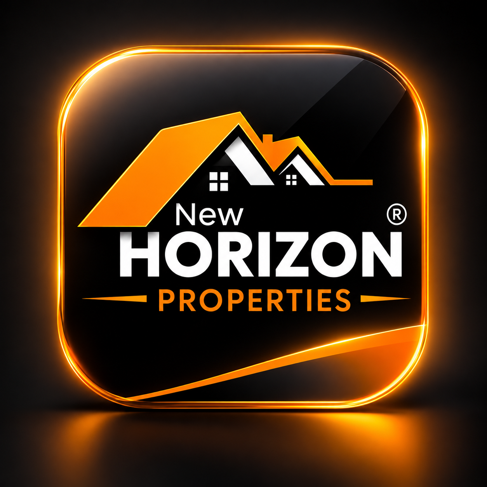

<div align="center">

  

  # 🏙️ New Horizon Properties

  ### *Ultra-Luxury Real Estate Management & Financial Advisory Platform*

  [](https://flutter.dev)
  [](https://dart.dev)
  [](https://flutter.dev)
  [](#license)

</div>

---

## 🌟 Overview

**New Horizon Properties** is an ultra-prime luxury real estate platform built with **Flutter**. It delivers an exclusive dual-experience ecosystem catering to high-net-worth investors and ultra-luxury real estate agencies. Designed with a signature **Dark Luxury Aesthetic** (Deep Charcoal `#0F0F10` accented with Gold & Warm Peach `#F7A10A`), the application combines high-end property showcases with sophisticated financial investment engines and agency management systems.

---

## 💎 Key Features & Capabilities

### 👑 1. Private Client & Investor Hub
* **Trophy Listing Gallery:** Browse ultra-prime estates, penthouses, luxury plazas, and commercial plots with real-time category filtering (Villas, Houses, Plazas, Shops, Plots).
* **Multi-Currency & Offer Filtering:** Real-time filtering by transaction types (For Sale, For Rent, Off-Plan) with formatted PKR pricing.
* **📈 ROI & Investment Engine:** 
  * Advanced financial calculator modeling gross & net rental yields, cash-on-cash return, and DSCR (Debt Service Coverage Ratio).
  * Interactive sliders for property price, down payment %, interest rate, loan tenure, yield %, and annual appreciation.
  * Real-time **Custom Canvas Growth Chart** rendering property equity and value projection over holding periods up to 20 years.
* **✈️ VIP Viewing Transport Booking:**
  * Request private property viewings via **Private Jet Charter**, **City Helicopter Transfer**, or **Chauffeur Luxury Ground Transport**.
  * Complete guest count management, custom date/time pickers, and live viewing request status tracking.
* **💼 Executive Leadership Directory:** Direct advisory booking and communication with Executive Directors and Senior Advisors.

---

### 🛡️ 2. Staff, Agent & Admin Management Suite
* **Role-Based Access Control (RBAC):** Granular permissions for **Admin**, **Manager**, and **Agent** roles.
* **📊 Live Analytics Dashboard:** Track key performance indicators (Total Sales Volume, Active Inventory Count, Lead Pipeline, Conversion Rates).
* **📋 Inventory & Listing Management:** Full CRUD suite to list, edit, publish, or archive luxury properties with custom amenities and spec tags.
* **🎯 Leads & Deal Pipeline Kanban:** Visual CRM tracking deal stages (*Inquiry*, *Viewing Scheduled*, *Offer Made*, *Under Contract*, *Closed Won/Lost*).
* **👥 Team & Staff Approval Desk:** Approvals queue for onboarding new advisors, role assignments, and team management.
* **👁️ One-Tap Client View Mode:** Instantly preview the platform as a client directly from the Staff Shell.

---

### 🔐 3. Authentication & Security
* **Biometric Authentication Sheet:** Integrated UI support for Face ID & Fingerprint verification.
* **Dual Login Flows:** Separate authenticated portals for Private Clients and Agency Staff.
* **Account Recovery & Safety:** Multi-step password reset flow featuring security question validation and OTP simulation.
* **Real-time Password Strength Meter:** Dynamic visual feedback during registration.

---

## 🎨 UI/UX Architecture & Design System

* **Luxury Dark Palette:**
  * Background: `#0F0F10`
  * Card Surface: `#18181A` / `#1C1C1F`
  * Accent Gold/Orange: `#F7A10A`
  * Warm Peach: `#FFB57D`
* **Adaptive & Responsive Layouts:** Responsive breakpoint system supporting Mobile bottom navigation, Tablet split views, and Desktop side navigation rails.
* **Micro-Animations:** Micro-interactions powered by custom press-scale transitions (`PressScale`), slide-fades (`FadeSlide`), tab sliders (`AnimatedTabSwitch`), and custom Canvas painters.

---

## 📂 Codebase Architecture & Structure

```
lib/
├── data/                    # Data models, mock stores & datasets
│   ├── listings.dart        # Real estate property listings dataset & helpers
│   ├── staff_data.dart     # Staff members data, roles & reactive stores
│   └── stores.dart          # In-memory stores for VIP Viewings & leads
├── screens/                 # Private Client & Shared screens
│   ├── auth_screen.dart     # Authentication container screen
│   ├── biometric_sheet.dart # Biometric login modal
│   ├── home_screen.dart     # Main Client hub with adaptive navigation
│   ├── hub_tab.dart         # Property browsing & search tab
│   ├── listing_detail_screen.dart # Detailed property showcase screen
│   ├── roi_engine_screen.dart     # ROI & Debt Engine with Custom Canvas chart
│   ├── staff_screen.dart    # Public leadership directory screen
│   └── vip_viewing_screen.dart    # VIP Transport & viewing booking form
├── staff/                   # Staff & Agency Management screens
│   ├── dashboard_tab.dart   # Executive dashboard & metrics
│   ├── listing_editor_screen.dart # Create / Edit listing interface
│   ├── listings_tab.dart    # Staff property inventory management
│   ├── pipeline_tab.dart    # Lead Kanban CRM & Deal tracking
│   ├── staff_shell.dart     # Staff portal shell & side navigation
│   └── team_tab.dart        # Staff approval desk & team directory
├── theme/                   # Design system & color tokens
│   └── app_colors.dart      # Application color palette & gradients
├── utils/                   # Navigation & responsive helpers
│   ├── app_nav.dart         # Global navigation bus
│   ├── helpers.dart         # PKR currency formatters, date pickers & toasts
│   └── responsive.dart      # Breakpoint utilities (Mobile / Tablet / Desktop)
└── widgets/                 # Custom reusable UI widgets
    ├── action_button.dart   # Standard themed action button
    ├── animated_tab_switch.dart # Custom smooth tab switcher
    ├── auth_field.dart      # Styled text input fields
    ├── gradient_button.dart # Animated gradient action button
    ├── listing_card.dart    # Luxury property card widget
    ├── press_scale.dart     # Interactive tactile touch feedback
    └── staff_ui.dart        # Custom avatars & staff badges
```

---

## 🚀 Getting Started

### Prerequisites
* [Flutter SDK](https://docs.flutter.dev/get-started/install) (`^3.13.2` or later)
* [Dart SDK](https://dart.dev/get-dart) (`^3.0.0`)
* Android Studio / VS Code with Flutter extension installed.

### Installation

1. **Clone the repository:**
   ```bash
   git clone https://github.com/your-username/new_horizon.git
   cd new_horizon
   ```

2. **Install dependencies:**
   ```bash
   flutter pub get
   ```

3. **Run the application:**
   * **Mobile / Desktop:**
     ```bash
     flutter run
     ```
   * **Web:**
     ```bash
     flutter run -d chrome
     ```

---

## 🛠️ Build & App Assets Setup

Generate app launcher icons and native splash screens:

```bash
# Generate Launcher Icons
flutter pub run flutter_launcher_icons

# Generate Native Splash Screen
flutter pub run flutter_native_splash:create
```

---

## 📱 Screenshots & Demo Highlights

| Client Property Hub | Financial ROI Engine | VIP Transport Booking | Staff Pipeline CRM |
|:---:|:---:|:---:|:---:|
| Luxury Listings Showcase | Custom Canvas Projections | Private Jet & Helicopter | Deal Kanban Tracker |

---

## 📄 License

This project is licensed under the MIT License - see the [LICENSE](LICENSE) file for details.

---

<div align="center">
  <sub>Built with ❤️ using <b>Flutter & Dart</b> for New Horizon Properties.</sub>
</div>
